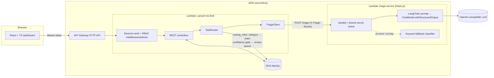

# LeadLantern

**LLM-routed CRM task triage.** Inbound CRM work (emails, call notes, chats, web forms) is
classified by an LLM into a category, priority and sentiment, then routed to the right team
queue. Low-confidence results go to a human review queue, and every routing decision is
stored so you can audit it.

- **Laravel REST API** (PHP 8.2, MySQL) with Sanctum token auth and role-based access control
  (admin / manager / agent, permission-based middleware, row-level task visibility).
- **Triage service** (Node.js 20, TypeScript, LangChain). It uses a prompt and a chat model with
  Zod-enforced structured output. If no API key is set or the LLM call fails, it falls back to a
  keyword classifier.
- **React + TypeScript dashboard** for routing stats, a filterable task queue, task detail with
  routing history and manual override, contact interaction timelines, and routing-rule admin.
- **Serverless on AWS Lambda.** The Laravel API runs through Bref (PHP-FPM layer) behind an HTTP API,
  the triage service runs as a native Node Lambda with a Function URL, and the data lives in RDS MySQL.

## Architecture



### Routing flow

1. A task is created directly (`POST /api/tasks`) or from an inbound interaction
   (`POST /api/contacts/{id}/interactions` with `create_task: true`).
2. `TaskRouter` sends the task, contact info and the last 5 interactions to the triage service.
3. The triage service returns `{category, priority, sentiment, confidence, rationale, suggested_actions, source, model, latency_ms}`.
4. Laravel looks up the active `routing_rule` for the category to pick the team. The rule's
   `default_priority` is a minimum: the LLM can raise priority but can't lower it below that.
5. If `confidence < TRIAGE_MIN_CONFIDENCE` (default 0.6), the category has no rule, or the triage
   service is unreachable, the task goes to the **Triage Review** team with status `needs_review`.
6. Every attempt is saved as a `routing_decision` row (`llm`, `fallback` or `manual`). The dashboard
   uses these rows to report average confidence, latency, and how often humans override the LLM.

### RBAC

| Permission | admin | manager | agent |
|---|:-:|:-:|:-:|
| `tasks.view_all` (otherwise own team / assigned only) | ✓ | ✓ | |
| `tasks.create`, `tasks.update` | ✓ | ✓ | ✓ |
| `tasks.route` (re-run triage, manual override) | ✓ | ✓ | |
| `contacts.manage` (contacts + interactions) | ✓ | ✓ | ✓ |
| `routing_rules.manage` | ✓ | ✓ | |
| `reports.view` (dashboard stats) | ✓ | ✓ | |
| `teams.manage`, `users.manage` | ✓ | | |

The API enforces these rules through `permission:` route middleware, `TaskPolicy`, and the
`Task::visibleTo()` scope. The frontend uses the same permission list only to hide controls the
user can't use.

## Repository layout

```
backend/          Laravel 11 API (models, migrations, RBAC, TaskRouter, tests, serverless.yml for Bref)
triage-service/   Node.js + TypeScript + LangChain classifier (Lambda handler, local server, vitest)
frontend/         React 18 + TypeScript + Vite dashboard
docker-compose.yml  Local MySQL
Makefile          setup / dev / test / deploy shortcuts
```

## Running locally

Prerequisites: PHP 8.2+ with Composer, Node.js 20+, and Docker (for MySQL). An OpenAI API key, or a
key for any OpenAI-compatible endpoint, is optional. Without one, the triage service uses the keyword classifier.

```bash
make setup          # installs deps, copies .env.example files, generates APP_KEY
# Set the same TRIAGE_SHARED_SECRET in backend/.env and triage-service/.env
# Optionally set OPENAI_API_KEY (and OPENAI_MODEL / OPENAI_BASE_URL) in triage-service/.env
make db             # starts MySQL in Docker, runs migrations and seeds demo data

# in three terminals
make dev-triage     # http://localhost:3001  (GET /health, POST /triage)
make dev-api        # http://localhost:8000/api
make dev-web        # http://localhost:5173  (proxies /api to :8000)
```

Seeded logins (password `password`):

| Email | Role |
|---|---|
| `admin@leadlantern.test` | admin |
| `manager@leadlantern.test` | manager |
| `sales.agent@leadlantern.test` | agent (Sales team) |
| `support.agent@leadlantern.test` | agent (Support team) |

The seed creates four unrouted demo tasks. Open one as the manager and click **Re-run LLM triage**.

### API quick tour

```bash
TOKEN=$(curl -s localhost:8000/api/auth/login -H 'Content-Type: application/json' \
  -d '{"email":"manager@leadlantern.test","password":"password"}' | jq -r .token)

curl -s localhost:8000/api/tasks -H "Authorization: Bearer $TOKEN" -H 'Content-Type: application/json' \
  -d '{"title":"Refund please","description":"I was charged twice for March."}' | jq

curl -s "localhost:8000/api/tasks?status=needs_review" -H "Authorization: Bearer $TOKEN" | jq '.data[].title'
curl -s localhost:8000/api/dashboard/stats -H "Authorization: Bearer $TOKEN" | jq .routing
```

Main endpoints: `POST /auth/login`, `GET /auth/me`, `GET|POST /tasks`, `GET|PATCH|DELETE /tasks/{id}`,
`POST /tasks/{id}/route`, `POST /tasks/{id}/override`, `GET /tasks/{id}/decisions`,
`GET|POST /contacts`, `GET /contacts/{id}`, `GET|POST /contacts/{id}/interactions`, `GET /teams`,
`GET|POST|PATCH|DELETE /routing-rules`, `GET|POST|PATCH /users`, `GET /dashboard/stats`.

## Testing

```bash
make test           # runs all three suites
make test-api       # PHPUnit (SQLite in-memory; triage HTTP faked with Http::fake)
make test-triage    # vitest: fallback classifier, prompt formatting, handler auth/validation/fallback
make test-web       # vitest + Testing Library component tests
```

The backend feature tests cover login, RBAC visibility and forbidden actions, LLM routing to rule
teams, the confidence gate, the priority minimum, the fallback when the triage service is down,
manual overrides, and interaction → task creation. None of the test suites need an LLM key or a
running MySQL.

## Deploying to AWS

1. Create RDS MySQL in private subnets and a security group for the Lambdas.
2. Put the secrets in SSM Parameter Store under `/leadlantern/<stage>/`: `app-key`, `db-host`,
   `db-username`, `db-password`, `frontend-url`, `triage-url`, `triage-secret`, `openai-api-key`,
   `lambda-sg-id`, `private-subnet-ids`.
3. Run `make deploy-triage`, then put the Function URL it prints into `/leadlantern/<stage>/triage-url`.
4. Run `make deploy-api`. It deploys Laravel through Bref and runs `migrate --force` in the console Lambda.
5. Run `VITE_API_URL=https://<api-id>.execute-api.<region>.amazonaws.com make build-web` and upload
   `frontend/dist` to S3 + CloudFront (or any static host).

## Configuration reference

| Variable | Where | Purpose |
|---|---|---|
| `TRIAGE_SERVICE_URL` | backend | Base URL of the triage service |
| `TRIAGE_SHARED_SECRET` | both | Sent as the `X-Triage-Secret` header; compared in constant time |
| `TRIAGE_MIN_CONFIDENCE` | backend | Confidence below which tasks go to manual review (default 0.6) |
| `TRIAGE_TIMEOUT_SECONDS` | backend | HTTP timeout for triage calls |
| `OPENAI_API_KEY` / `OPENAI_MODEL` / `OPENAI_BASE_URL` | triage-service | LLM provider (any OpenAI-compatible API) |
| `VITE_API_URL` | frontend | API origin for production builds |
